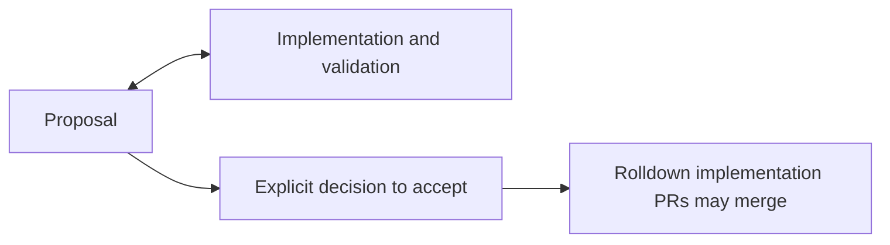

# Cache

Design and planning for caching in [Rolldown](https://github.com/rolldown/rolldown):
a persistent cache on disk, a cache shared across git worktrees, and incremental
builds that redo only the work whose cache key changed. The code itself lands in
Rolldown.

## Layout

| Path                             | What it holds                                                                     |
| -------------------------------- | --------------------------------------------------------------------------------- |
| [`goals.md`](goals.md)           | The end result of caching in Rolldown, and what is out of scope. Read this first. |
| [`principles.md`](principles.md) | Rules that every design follows.                                                  |
| [`design-docs/`](design-docs/)   | One record per feature or decision: what and why.                                 |
| [`milestones.md`](milestones.md) | The order of work, the features in each milestone, and their status.              |

## Goals and principles

To decide where an idea belongs, ask:

- **Goal:** Does this describe a result users should get?
  If yes, put it in `goals.md`. For example, different worktrees of the same
  project can reuse cached results.
- **Principle:** Does this give us a rule for accepting or rejecting a design,
  even when another choice offers benefits?
  If yes, put it in `principles.md`. For example, reject a faster design if
  caching can change the correct build result.

A concern can belong to both: correctness is a user goal and a design constraint.
Add a principle when it helps decide between designs; there is no need to create
a separate principle for every goal.

## Adding a design doc

1. Copy [`design-docs/0000-template.md`](design-docs/0000-template.md) to
   `design-docs/NNNN-short-name.md`, using the next free number.
2. Add the feature to its milestone in [`milestones.md`](milestones.md) and
   link the new doc.

## Design status and implementation

Each design doc records its status and implementation PRs in its frontmatter:

```yaml
status: proposal
implementation: []
```

- `proposal`: the design is still being explored or discussed.
- `accepted`: an explicit decision has been made to adopt the design.

Either status can appear on this repository's `main`. Implementation and
validation may start while the design is a proposal, but Rolldown implementation
PRs must not merge until the design is accepted. Acceptance does not imply that
implementation is complete.

List all Rolldown PR URLs that implement the design under `implementation`,
including every relevant PR in a stack. Do not link only the top PR. A PR link
does not imply completion; use the PRs to check implementation progress and
[`milestones.md`](milestones.md) to track delivery and acceptance checks.

For example, a storage prototype may reveal costs that lead to changes in the
proposal before the design is accepted:


