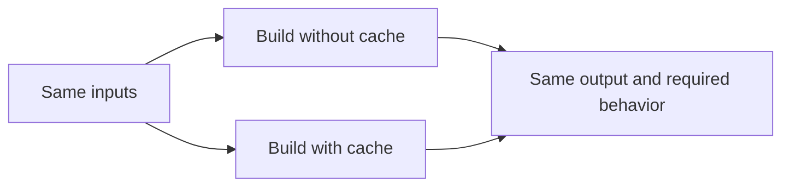

# Design principles

Every design doc in [`design-docs/`](design-docs/) follows these principles.

## 1. Caching must preserve correctness

Given the same inputs, using the cache must produce the same output and required
behavior as running without it. This applies regardless of the implementation
or its performance benefits.

**Why:** Users must be able to trust build results without knowing whether cached
results were used. Performance gains cannot justify incorrect results.

**Example:** After a source file changes, a cached build must match a clean build.
Reusing an outdated result that changes the output breaks this principle.

Required behavior includes plugin effects and diagnostics. Build time and
cache-specific logs are expected to differ.

## 2. Caching must save more work than it adds

The computation cost saved by caching must outweigh the cost of validating,
reading, writing, and maintaining the cache across representative workloads.

**Why:** A high hit rate or wider cache coverage does not necessarily make builds
faster. Cache boundaries and granularity should follow the overall benefit.

**Example:** If a computation takes 1 ms but reading its cached result takes 3 ms,
run the computation directly. Caching it just to increase the hit rate breaks
this principle.
