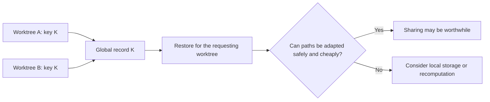
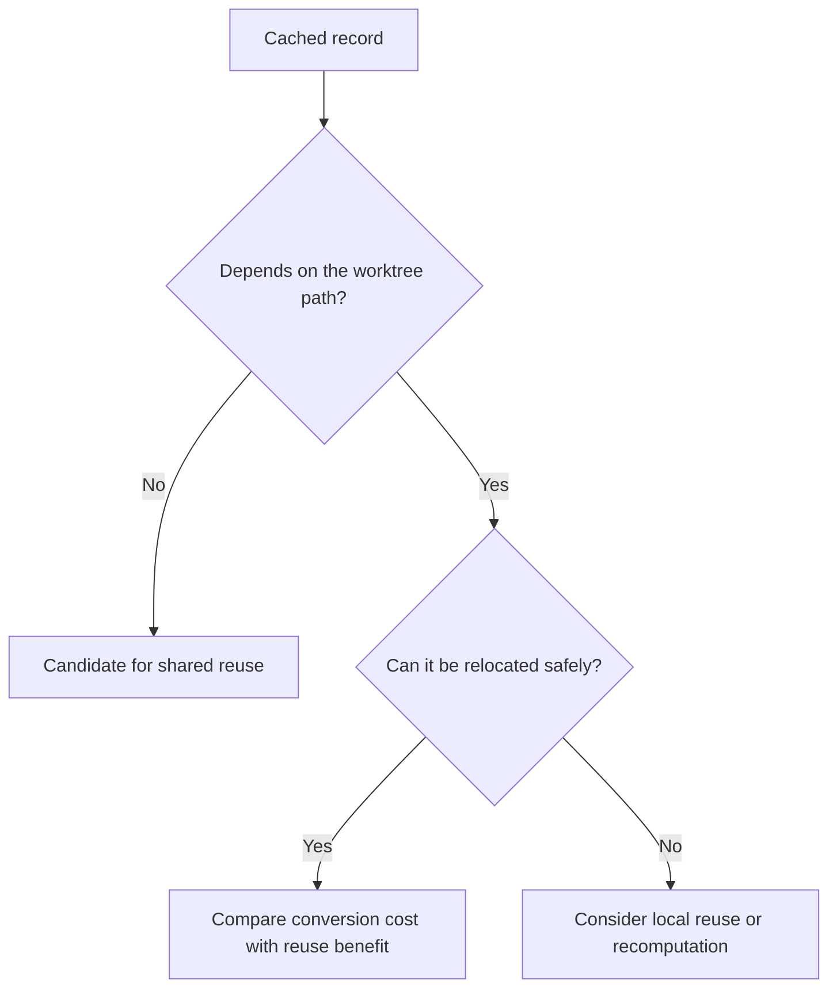

# Scratchpad

Unverified ideas and questions from discussion. These notes may be wrong.
They are not accepted designs or research findings. The agreed scope remains
in [goals.md](goals.md), [principles.md](principles.md), and
[milestones.md](milestones.md).

## Worktree sharing and local/global storage

- Each worktree is independent. There is no baseline worktree.
- Look for matching inputs across different worktrees. A global cache can hold
  many keys, including results for different configurations.
- A possible model: any worktree can reuse a global record when its computation
  key matches. This requires the key and restoration rules to make reuse safe.
- Different configurations do not necessarily require separate local caches.
  Their results could coexist under different global keys.
- Finer computation boundaries may preserve more reuse when inputs differ.
  They are not a prerequisite for sharing module-level scan results.
- Absolute paths in cached values may add a cost to sharing, rather than make
  sharing impossible. Safe path conversion and restoration may be needed.
- A possible choice: use global storage when reuse saves more than this extra
  cost; consider local storage when adaptation is unsafe or not worthwhile.
  The placement rule is not decided.

For example, worktrees A and B might produce the same key K. Both could use
the same global record. If that record contains A's absolute path, B must not
use it unchanged unless that path is also correct for B.

Here, sharing means worktrees of the same project. Cross-project reuse remains
outside the agreed goals.

### Open question: path handling in M2

[M2](https://github.com/h-a-n-a/cache/pull/2) requires reuse across worktrees
and project moves without invalidating the entire cache because the root path
changed. This does not necessarily require every cached result to be
path-independent.

Making records reusable across directories may require path conversion during
storage and restoration. That work could add overhead for users who only build
in one worktree.

Questions to explore:

- Which records need path conversion, and which can already be shared as they are?
- When does the reuse benefit outweigh the conversion cost?
- Should Rolldown choose automatically, or should users configure local and
  shared caching?
- Should path conversion be configurable separately from cache storage?

For example, a recorded dependency at `/A/theme.json` may be stored relative
to the project root and restored as `/B/theme.json`. An absolute path embedded
in plugin-generated code may have meaning that cannot be preserved by simply
replacing the root.

Local/global storage and path conversion are separate choices. Shared storage
can hold records that need no conversion. Enabling conversion does not make
every result safe to share.

No placement policy, conversion method, or user-facing option is decided.
