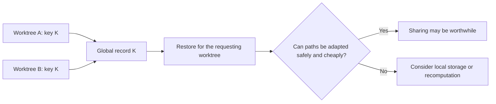

# Scratchpad

Unverified ideas and questions from discussion. These notes may be wrong.
They are not accepted designs or research findings. The agreed scope remains
in [goals.md](goals.md), [principles.md](principles.md), and
[milestones.md](milestones.md).

## Worktree sharing and local/global storage

- Each worktree is independent. There is no baseline worktree.
- Look for matching inputs across different worktrees. A global cache can hold
  many keys, including results for different configurations.
- A possible model: any worktree can reuse a global record when its computation
  key matches. This requires the key and restoration rules to make reuse safe.
- Different configurations do not necessarily require separate local caches.
  Their results could coexist under different global keys.
- Finer computation boundaries may preserve more reuse when inputs differ.
  They are not a prerequisite for sharing module-level scan results.
- Absolute paths in cached values may add a cost to sharing, rather than make
  sharing impossible. Safe path conversion and restoration may be needed.
- A possible choice: use global storage when reuse saves more than this extra
  cost; consider local storage when adaptation is unsafe or not worthwhile.
  The placement rule is not decided.

For example, worktrees A and B might produce the same key K. Both could use
the same global record. If that record contains A's absolute path, B must not
use it unchanged unless that path is also correct for B.

Open question: which actual scan records need path adaptation, and what would
that adaptation cost compared with the computation it saves?

Here, sharing means worktrees of the same project. Cross-project reuse remains
outside the agreed goals.
